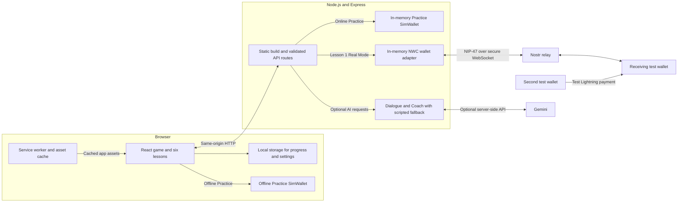

# Marché Éclair

Marché Éclair is a French and English market game that teaches first-time users how to receive Bitcoin Lightning payments. Its primary user is a market vendor in West Africa learning on a phone that may have intermittent connectivity. At a busy stall, a vendor needs to know how to request the right amount, confirm that the payment arrived, and recognize a misleading screenshot or message.

Players run a stall and work through six short lessons on receiving payments, invoice expiry, fees and speed, channel liquidity, routing, and scams. Each lesson pairs an interactive scenario with a two-question check. The game includes a glossary, a Friendly Coach, and a progress screen. See the [three-minute demo script](DEMO.md) for a walkthrough.

## Run locally with one command

From the repository root, run the following with Docker and Docker Compose running.

```sh
docker compose up
```

With Node.js 24 and npm installed, you can use the npm launcher.

```sh
npm run judge
```

Both commands install dependencies, build the app, and serve it at [http://localhost:3000](http://localhost:3000). The first run needs internet access to fetch dependencies. Choose a language and stall, then start Lesson 1 in Practice Mode.

### Environment variables

| Variable | Purpose |
| --- | --- |
| `GEMINI_API_KEY` | Optional server-side key for live dialogue and Coach answers. The game uses scripted responses when the key is empty or Gemini is unavailable. Set it in your shell or copy [`.env.example`](.env.example) to `.env` and fill it in. Both judge launchers read `.env`. |
| `NODE_ENV` | The judge launchers set this to `production` to serve the built frontend. |
| `DISABLE_HMR` | Development only. Set to `true` in the shell before `npm run dev` to turn off Vite’s file watching and hot reload. |

Enter your Nostr Wallet Connect (NWC) credential only in the Real Mode dialog.

## Architecture



## Practice Mode and Real Mode

| Mode | What happens |
| --- | --- |
| **Practice Mode** | The default for all six lessons. SimWallet creates and settles simulated invoices with play sats. Credentials and external wallets are unnecessary. |
| **Real Mode (test network only)** | Lesson 1 creates a test Lightning invoice through NWC and checks for settlement after a second test wallet pays it. Lessons 2–6 use the simulator. The app receives test payments and blocks outbound payment methods. |

### How to test Real Mode safely

1. Use your own local instance on a trusted machine. Docker publishes the app only on loopback. With the npm launcher, keep port 3000 private while testing. Prepare an NWC-capable receiving wallet and a second, funded test wallet on the same Lightning test network. Verify the network in both wallets and use a tiny test balance.
2. Create a short-lived NWC connection restricted to `make_invoice`, `lookup_invoice`, and `get_balance`. The connection check may also query `get_info` if the wallet supports it. Leave spending permissions disabled. The app server needs outbound `wss://` access to the wallet’s Nostr relay.
3. Open **Real Mode (Test network only · NWC)**, paste the connection string, and select **Run connection check**. On success choose **Connect Real Mode (Lesson 1)** and open Lesson 1.
4. Create an invoice and copy its BOLT11 string into the second wallet. The invoice graphic is illustrative. Verify the network and amount in the paying wallet before sending test sats. The game polls for settlement. Confirm that the invoice shows as paid in the game and that the receiving wallet shows the payment.
5. Select **Clear from session memory** in the NWC dialog, then revoke the temporary connection in the receiving wallet.

The existing tests cover simulated payments, NWC with a stub client, and mainnet refusal checks without wallet credentials. After dependencies are installed, run `node --import tsx --test src/shared/simWallet.test.ts`.

## Design for low bandwidth

- The installable web app caches its shell and assets via a service worker. Open it online first and let the lesson assets load. Once cached, Practice Mode can run with a browser-side simulator and scripted text during connectivity loss.
- The first view loads ahead of the lesson and illustration chunks. The game uses code splitting, lightweight SVGs, and local storage for settings and progress.
- **Data Saver** uses built-in customer dialogue and Coach answers, skipping AI requests. Try it after the first online load, then turn off networking and replay a Practice lesson to see the fallback.

## Security

Real Mode keeps the NWC credential in server memory and clears it on explicit disconnect. The app checks for mainnet indicators in the URI, wallet metadata when available, and the invoice prefix. It disables NWC spending methods. API protections include schema validation, rate limits, log redaction, and security headers. Gemini receives lesson context and, for the Coach, the learner’s submitted question. It has no wallet access. See the [threat model](THREAT_MODEL.md) for details and residual risks.

## Limitations

- This is an educational prototype. Wallet state is shared within a server process, and the app has no accounts or isolated learner sessions. Use a private local instance for Real Mode.
- Offline play depends on a completed online load and browser cache retention. Progress is tied to that browser. Clearing site data erases it.
- Real Mode relies on reachable test wallets and a Nostr relay. The initial mainnet check depends in part on metadata the wallet may omit. The external wallet verifies the BOLT11 invoice and displays the amount. Copy and paste is the payment handoff for the demo.
- Simulation outcomes are scripted examples. Live Lightning fees, routing, and timing vary, and optional AI explanations can be imprecise.

## Metrics to track

These are proposed pilot measures. The prototype stores individual progress locally. Aggregate analytics and pilot results are still pending.

| Metric | How to measure it |
| --- | --- |
| Lessons completed | Count distinct lesson completions per learner. Record completion after both questions in the lesson check are answered. |
| Scam-quiz accuracy | Divide correct first answers in the Lesson 6 quiz by all first answers submitted. Review each question separately to identify misconceptions. |
| Drop-off per lesson | Among learners who start a given lesson, measure the share who have yet to complete it by the end of a defined follow-up period. |

## Next iteration

Pilot the game with first-time vendors in both languages on low-cost phones and intermittent connections. With consent, collect the proposed measures and observe whether learners verify the amount and settlement independently. Use the results to revise confusing lessons. Improve cache reliability, make the Real Mode invoice QR scannable, and isolate wallet sessions before a shared deployment.

## Credits and license

The concept was inspired by the idea of making payments understandable through a game. No code was reused from that inspiration.

The project’s original contributions are available under the [MIT License](LICENSE). Existing file-level license notices continue to apply where present.
